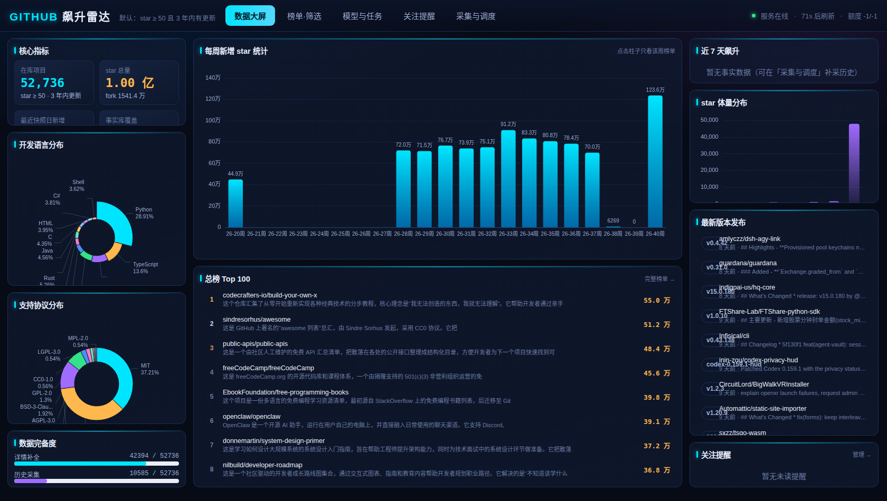
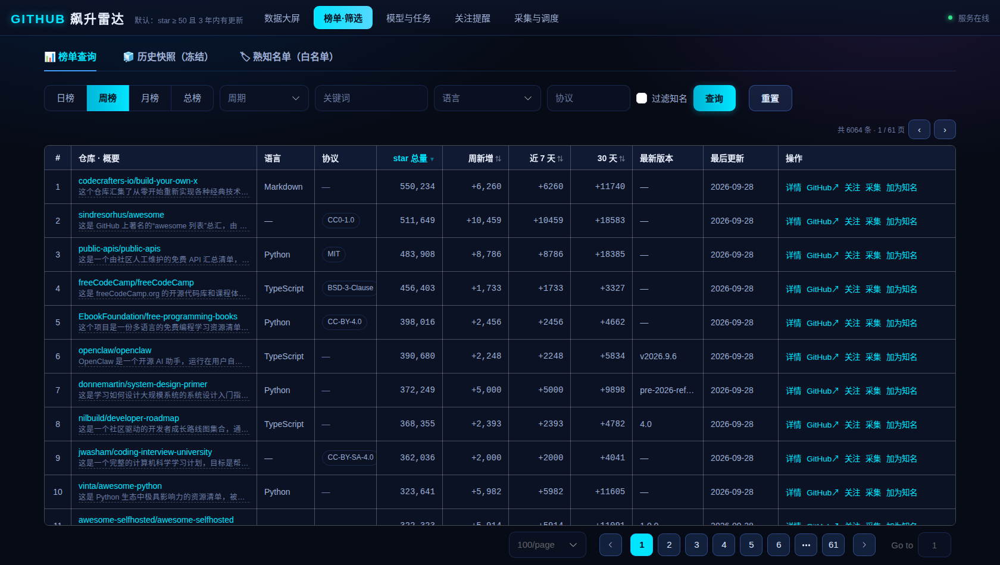
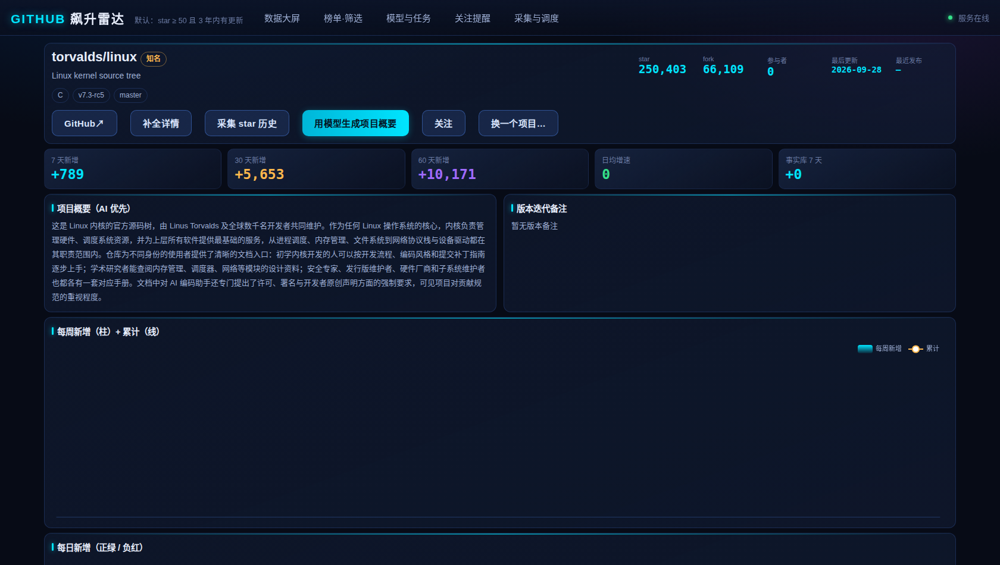
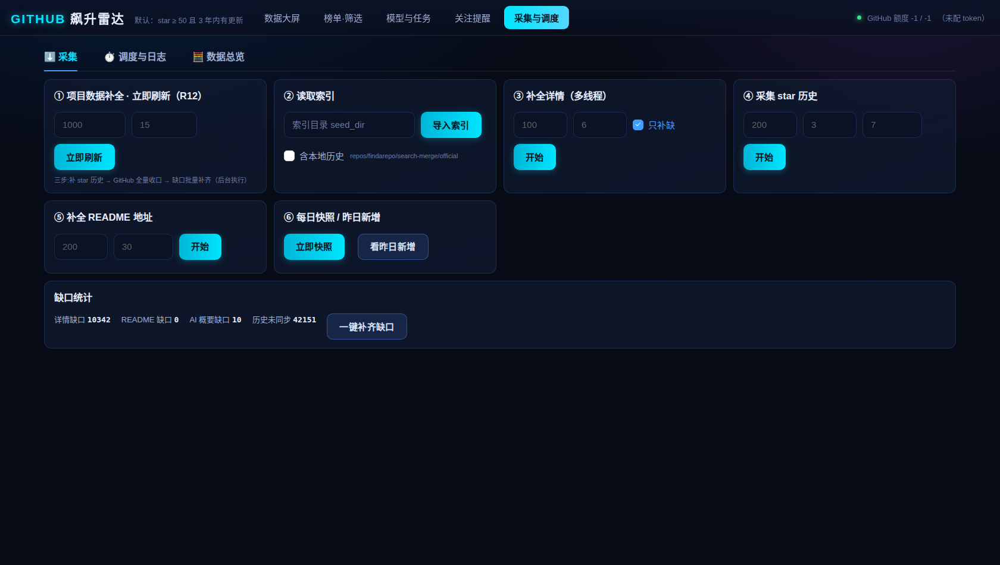

<div align="center">

# 📡 GitHub 飙升雷达 · GitHubStarRadar

**谁在涨、涨了多少、到底是做什么的 —— 一屏看完，还都是中文**

不再靠「感觉热门」挑项目。直接用 GitHub 官方 star 事件自己算榜：**日榜 · 周榜 · 月榜 · 总榜**，
再给每个项目配一段 AI 生成的全中文介绍 —— **打开就是中文周榜、中文飙升榜，每个项目是干嘛的一眼懂，不用再猜。**

> 💡 **全中文亮点**：榜单页全中文 ｜ 每个项目都有 AI 中文简介（120–250 字）｜ 中文周榜 / 中文月榜 / 中文飙升榜 ｜ 英文项目不用啃 README，悬停即看中文

<a href="https://git.ldquanyi.cn/" target="_blank" rel="noopener">🌐 <b>在线演示 → git.ldquanyi.cn</b></a>

`Docker` 一条命令自托管 ｜ 数据全部落在你自己的 PostgreSQL ｜ 前端零构建、离线可用

</div>

---

## 一、这是个什么东西

GitHub 每天都在冒新项目，但「**最近谁在涨**」这件事没有现成答案：

- Trending 页只看当天，**翻页就没了** —— 没有历史、没有曲线、不能筛选；
- star 总量榜看不出「本周新增多少」，老牌项目永远排在最前面；
- 想找「**最近一周涨得最快的 AI 项目**」「**近 30 天 star 增长最多的 Rust 项目**」—— 无处可查；
- 想知道一个英文项目到底做什么，还得点进去硬啃 README。

**GitHub 飙升雷达**把这件事做成一套自托管服务：定期同步每个仓库的 star 历史 → 按真实 star 增量算出日/周/月/总榜 → 用你自己配置的大模型给项目写中文概要 → 用暗色数据大屏 + 榜单筛选页 + 项目详情页展示。

全流程跑在你自己机器上，**不依赖任何第三方统计服务**。

### 它能回答什么

| 你想知道的 | 打开哪个 |
|---|---|
| 最近一周涨 star 最快的是谁？ | **周榜** |
| 今天冒出来的新兴项目有哪些？ | **日榜**（数据不足时自动降级为近 7 天日均） |
| 过去 30 天 star 增长最多的是谁？ | **月榜** |
| GitHub 上最著名的项目排行？ | **总榜**（全库按 star 总量） |
| 某个项目的 star 曲线、最近涨了多少？ | 项目详情页（每周新增柱状 + 累计折线） |
| 这个英文项目到底是做什么的？ | AI 中文概要（榜单里直接看，不用点进去） |
| 怎么持续监控某类项目、盯住涨星异常？ | 关注提醒 + 定时任务 + 历史快照回看 |

---

## 二、界面预览

|  |  |
|:---:|:---:|
| **① 数据大屏** —— 核心指标 · 语言/协议分布 · 每周新增柱状 · 总榜 Top100 | **② 榜单 · 筛选** —— 日/周/月/总榜切换 + 关键词 / 语言 / 协议筛选 |
|  |  |
| **③ 项目详情** —— star 增长曲线 · AI 中文概要 · 版本迭代备注 | **④ 采集与调度** —— 补全详情 / 采集 star 历史 / 缺口一键补齐 |

> 点任意图片或访问 <a href="https://git.ldquanyi.cn/" target="_blank" rel="noopener"><b>https://git.ldquanyi.cn/</b></a> 亲自翻一遍。

---

## 三、最近两周飙升 TOP 25

> 取自本项目的自采数据：**近 14 天 star 净增排名**（来源 `gh_repo_star_daily`），中文概要由项目内置的 AI 概要任务生成。

| # | 项目 | 中文概要 |
|---|---|---|
| 1 | [`MadsLorentzen/ai-job-search`](https://github.com/MadsLorentzen/ai-job-search) | 这是一个构建在 Claude Code 之上的 AI 求职申请框架，作者本人用它完成了从地球物理学家到 AI 工程师的转行求职。它把求职拆成可复用的结构化工作流：先填写个人资料完成自画像，再通过 /scrape 在招聘网站搜索并评估匹配度，随后用 /apply 针对具体职位生成定制简历与求职信，最后交由评审代理提出修改意见并迭代定稿，同时包含面试准备环节。招聘门户的搜索技能目前面向丹麦市场，但评估与申请流水线本身与语言、国家无关，可以替换为本地平台。项目基于 Python，需配合 Claude Code、Bun 与 LaTeX 使用，适合希望把求职过程自动化的开发者。 |
| 2 | [`Leonxlnx/taste-skill`](https://github.com/Leonxlnx/taste-skill) | taste-skill 是一组面向 AI 编程智能体的可移植技能包，目的是让 AI 生成的界面摆脱千篇一律的模板感，真正具备设计品味。它以 Agent Skills 的形式分发，安装后可以配合 Codex、Cursor、Claude Code 等工具使用，从布局、字体排版、动效和间距等层面约束并提升前端产出的质量，被作者称作"反套路前端框架"。除了代码类技能，仓库还提供用于生成参考图的图像技能，可以先产出网页、移动端或品牌套件的视觉稿，再交给智能体落地实现，从而形成从设计到编码的连贯流程。项目以 MIT 协议开源，支持通过命令行一键添加单个或全部技能。 |
| 3 | [`diegosouzapw/OmniRoute`](https://github.com/diegosouzapw/OmniRoute) | 一个用 TypeScript 编写的免费 AI 网关，把几百家模型服务商收敛到同一个端点后面，让 Claude Code、Codex、Cursor、Cline、Copilot 等工具通过一次配置就能调用 Claude、GPT、Gemini、Kimi、DeepSeek、GLM 等主流模型，其中相当一部分提供免费额度，合计每月可观的免费 Token 预算会直接显示在仪表盘上。 它按配额做调度，某个渠道触顶或失败时自动切换到下一个，避免编码过程被限流打断；内置的压缩策略还能显著削减 Token 消耗。项目同时提供 MCP/A2A 支持、桌面端与 PWA，并允许自带密钥、按需组合路由策略，让"永不停止编码"成为一种可持续的状态。 |
| 4 | [`harry0703/MoneyPrinterTurbo`](https://github.com/harry0703/MoneyPrinterTurbo) | 一个用 Python 编写的一站式 AI 短视频生成工具，用户只需给出视频主题或关键词，它就能自动走完整条流水线：撰写视频脚本、提炼素材搜索关键词、匹配画面素材、生成字幕与背景音乐，最后合成一段高清短视频。 它同时提供 Web 界面与 API，方便人工调试或接入其他系统批量生产，并对多家大模型服务商保持开放，可按需更换文案与素材来源。对于需要持续产出内容的创作者来说，它把过去繁琐的找素材、配字幕、对时间轴等工作压缩成一次提交，显著降低了短视频制作的启动成本。 |
| 5 | [`calesthio/OpenMontage`](https://github.com/calesthio/OpenMontage) | OpenMontage 是首个开源的智能体视频制作系统，把 AI 编码助手变成一间完整的视频工作室。用户只需用自然语言描述想要的内容，智能体便会接手调研、写脚本、生成素材、剪辑和最终合成。它提供 12 条制作流水线、100 多个工具以及 700 多份智能体技能与制作知识文件，覆盖从概念到成片的各个环节。与把几张静图做成伪视频的做法不同，它可以从免费素材库和开放档案中检索真实动态片段，剪辑成时间线并渲染出成片，也能结合 Veo、Kling 等模型生成视频片段，配合配音、配乐、逐词字幕与 Remotion 合成，让个人和小团队以很低的成本完成预告片、动画短片等作品。 |
| 6 | [`nextlevelbuilder/ui-ux-pro-max-skill`](https://github.com/nextlevelbuilder/ui-ux-pro-max-skill) | UI UX Pro Max 是一个为 AI 编程助手提供设计智能的技能包，目的是让模型在生成界面时不再套用千篇一律的模板。它内置约 192 条推理规则和 79 种可检索的 UI 风格，能根据项目类型、目标用户和转化目标，推演出完整的设计方向。 其核心是设计系统生成器：输入类似“高端水疗品牌”这样的需求，它会给出页面结构、风格关键词、色彩与字号体系、CTA 位置以及各部分顺序，并说明适用场景与性能取舍。技能以 Python 实现、MIT 协议开源，覆盖 Web 与移动端多种平台和框架，可配合 npm 命令行工具安装，帮助缺乏设计师的团队快速产出专业而连贯的界面方案。 |
| 7 | [`msitarzewski/agency-agents`](https://github.com/msitarzewski/agency-agents) | The Agency 是一个 AI 智能体角色集合，把不同岗位的专家整理成可直接调用的代理人格。每个代理都有明确的领域专长、独特的表达风格和具体工作流程，并非泛泛的提示词模板，而是围绕可交付成果设计，附带代码示例、成功指标与沟通方式，覆盖前端开发、后端架构、移动应用、AI 工程、DevOps、社区运营、文案创意等众多分工。使用者可以按需把某个代理安装进 Claude Code、Cursor、Codex、Gemini CLI、OpenCode 等工具，在对话中激活对应角色来协作完成任务。项目还提供桌面应用与脚本化安装方式，支持只挑选需要的团队，适合想用一组现成“专家”提升开发与内容工作效率的人。 |
| 8 | [`firecrawl/firecrawl`](https://github.com/firecrawl/firecrawl) | 一个面向大规模网页数据的 API，为 AI 应用与智能体提供搜索、抓取和页面交互能力。它能把任意 URL 转成干净的 Markdown、结构化 JSON 或截图，代开发者处理 JavaScript 渲染、代理轮换、限流等繁琐环节，省去自建爬虫基础设施的成本。 核心接口包括搜索并返回结果正文、单页抓取、按提示或代码对页面进行点击滚动等操作，此外还有只需描述需求即可自主搜集数据的 Agent、一次请求抓完整站的 Crawl、快速列举站点链接的 Map，以及异步批量抓取数千个 URL。它支持解析网页上的 PDF、DOCX 等文档，既提供官方托管服务，也可自行部署。 |
| 9 | [`usestrix/strix`](https://github.com/usestrix/strix) | Strix 是一个开源的 AI 渗透测试工具，用自主的 AI 代理扮演「黑客」，动态运行你的代码、寻找漏洞，并通过真实可复现的验证过程确认问题确实存在。它瞄准的是这样一类需求：既不想承担人工渗透测试的高昂开销，又厌倦了静态分析工具大量误报的开发者与安全团队，希望获得快速、准确、能落地的安全测试结果。 它的能力覆盖完整的渗透测试工具链，从信息侦察、漏洞利用到结果验证都可以开箱使用，并支持多代理协同编排，让一组 AI 渗透测试员分工合作、按需扩展。与遗留漏洞扫描器不同，Strix 强调以可工作的 PoC 来验证漏洞，输出带修复指引的结论，并能生成补丁和符合合规要求的渗透测试报告。它可以用于应用安全测试、快速渗透测试、漏洞赏金自动化，也能接入 CI/CD 流水线，在每次拉取请求时自动扫描，尽量把不安全的代码挡在生产环境之外。 |
| 10 | [`earendil-works/pi`](https://github.com/earendil-works/pi) | 一个 AI 智能体工具链项目，把可自我扩展的编码智能体拆成若干可复用的软件包。最上层是交互式编码智能体命令行工具，底层则有统一多家服务商的 LLM 接口，兼容 OpenAI、Anthropic、Google 等，还有带工具调用与状态管理的智能体运行时、具备差分渲染能力的终端 UI 库、持久化的对话与任务运行时，以及面向遥测和服务编排的配套组件。 项目默认不内置权限限制系统，直接以启动用户的权限运行，因此官方建议通过容器或沙箱约束文件、网络与凭据访问。它还强调供应链安全，固定依赖版本、锁定锁文件，并把依赖变更当作代码变更来审查。 |
| 11 | [`mattpocock/skills`](https://github.com/mattpocock/skills) | 这是 TypeScript 社区知名开发者 Matt Pocock 公开的一组 AI 编码代理技能集，来自他日常工作使用的配置目录，目标是让 AI 真正参与严肃工程，而不是停留在随意的“氛围编程”。它针对代理开发中的两个典型痛点给出方案：一是需求对齐，通过 /grill-me 和 /grill-with-docs 这类“拷问”技能，让代理在你动手改代码前反复追问细节，把模糊的想法逼成明确的需求；二是沟通冗长，借助一份共享语言文档来统一项目术语，使代理用一句话替代原本二十句的啰嗦描述。这些技能刻意做得小巧、易改、可组合，不绑定特定模型，也不像某些全流程框架那样接管你的开发过程。安装方式有两种，既可以作为 Claude Code 插件订阅式使用，也可以用 skills.sh 把可编辑的技能文件直接拷进自己的仓库，随意改造。 |
| 12 | [`zhaoxuya520/reverse-skill`](https://github.com/zhaoxuya520/reverse-skill) | 一套面向逆向工程、授权渗透测试与安全研究的技能路由包，解决的是 AI 编码客户端面对 APK、二进制、前端 JS 加密、CTF 题目或渗透目标时无从下手的问题。它按规则把任务路由到对应的方法论，检查本机可用工具，再执行可重复的工作流，而不是让智能体凭猜测敲命令。 包内包含四十余条路由规则、数十个核心技能模块与回归基准，覆盖 jadx、apktool、Frida、IDA、BurpSuite 等常见工具链，支持按需自举环境，并以证据到结论再到路径的结构化方式沉淀时间线与报告，把每次任务的经验回流进不断进化的知识库。它不绑定具体客户端，Claude Code、Cursor、Cline 等都能接入。 |
| 13 | [`OpenCut-app/OpenCut`](https://github.com/OpenCut-app/OpenCut) | OpenCut 是一个免费开源的视频编辑器，定位为剪映同类工具的开放替代方案，目标是把专业剪辑能力带到网页、桌面和移动端。目前项目正在从零重写，希望用一套基于 Rust 核心的代码库同时覆盖浏览器、桌面与移动平台，并引入编辑器 API 和插件优先的架构，让第三方可以深度扩展功能。规划中的能力还包括面向 AI 智能体的 MCP 服务、用于自动化与批量渲染的无头模式，以及编辑器内置的脚本标签页。现阶段可以直接使用的是经典版本，线上站点仍运行该版本，重写版会在准备就绪后逐步接管。项目采用 MIT 协议，欢迎通过 Discord 或 issue 参与讨论。 |
| 14 | [`anywhere-labs/dsh-desktop`](https://github.com/anywhere-labs/dsh-desktop) | 这是为 DeepSeek Harness 插件生态打造的桌面客户端，把上游的本地 Web UI、Host 服务与插件系统整合进原生应用，让 Windows 和 macOS 用户无需安装 Node.js 或敲命令，下载安装即可使用。项目固定并原样运行特定上游版本，自己只负责窗口、托盘、终端、更新与工作配置，并通过上游插件机制完成能力组合，贯彻"万物皆插件、桌面本身也是插件"的思路。 它内置插件市场，支持插件的发现、查看、安装与管理，还提供手机端远程连接，让用户在移动设备上发起任务、跟进智能体进度。项目为独立社区开源项目，与 DeepSeek 官方不存在隶属或背书关系。 |
| 15 | [`cathrynlavery/diagram-design`](https://github.com/cathrynlavery/diagram-design) | 这是一个面向 Claude Code、Codex、Pi 等 AI 编程客户端的图表设计技能包，意在让 AI 生成的配图摆脱千篇一律的圆角方框，做出杂志编辑质感的图示。成品是自包含的 HTML 加 SVG，不依赖构建步骤、JavaScript 或外部图片，浏览器直接打开即可，并自带简约浅色、深色与完整编辑风三套静态样式，也能读取站点自动匹配品牌配色。 它覆盖架构、流程、时序、状态机、ER、时间线、泳道、象限、雷达、飞轮环、金字塔、桑基、鱼骨、Wardley 图、UML 类图、数据库模式等数十种版式，并用语义模式把行为与排版分开描述；遇到 draw.io、Mermaid、Excalidraw 的旧图时，还能按指定格式、尺寸与细节层级重绘。 |
| 16 | [`debpalash/VoiceStudio`](https://github.com/debpalash/VoiceStudio) | 它是完全本地运行的开源语音工作台，定位是 ElevenLabs 的自托管替代品。语音克隆、语音设计、视频配音、听写、转录和有声书制作被整合进同一个桌面应用，覆盖 646 种语言，本地流程全部跑在自己的硬件上，远程服务可选，分析数据需要用户同意才会采集。 功能上，你可以用一段干净的参考录音克隆声音，也可以直接描述想要的声音风格让系统设计出来；配音工作区能把带时间轴的语音贴到视频上；听写则以悬浮小工具的形式随时可用；故事、有声书和批量任务都有对应入口。模型可以在应用内安装和管理，默认引擎基于 k2-fsa/OmniVoice，也支持替换其他引擎，并提供本地 API 和 MCP 供智能体调用。安装支持一条命令脚本，或直接把安装提示交给编码助手执行，桌面端已统一为 Electron 实现。 |
| 17 | [`openai/codex`](https://github.com/openai/codex) | Codex CLI 是 OpenAI 推出的本地编码智能体，直接运行在终端里，帮助开发者在命令行中读写代码、执行命令与排查问题。它解决的是把 AI 能力嵌入真实开发环境的问题：无需离开终端，用户就能让智能体理解代码库、修改文件并运行测试，把对话式辅助变成可落地的编码流程。 它由 Rust 编写、以 Apache-2.0 协议开源，支持 macOS、Linux 与 Windows，可通过安装脚本、npm 或 Homebrew 快速部署。使用时既能用 ChatGPT 账号登录，借助 Plus、Pro、Business 等订阅额度，也支持 API Key 方式接入。除命令行外，同一套能力还能安装到 VS Code、Cursor 等编辑器，或通过桌面应用与网页版使用，覆盖本地与云端多种工作方式。 |
| 18 | [`bilawalsidhu/gods-eye-view`](https://github.com/bilawalsidhu/gods-eye-view) | 它把浏览器变成一个间谍卫星模拟器，但让人意外的是，屏幕上呈现的并非虚构数据，而是来自公开渠道的真实信息。项目把航班应答机、船舶信标、卫星轨道根数、地震台站和公共摄像头等原本分散的公开信号汇聚到同一个逼真的三维地球上，让用户可以在宏观全球态势与某一架飞机、某一艘船、某条街道之间自由切换，且代码完全本地运行、可检查可扩展。 在玩法上它做得相当丰富：可以进入被追踪航班的座舱视角贴着地形飞行，一键锁定任何移动目标并查看完整元数据，用语音在世界地图上画出边界与航线，把追踪对象切换成波音 787、MQ-9 等按机型建模的三维模型，还能叠加 FLIR、夜视、CRT 等传感器滤镜和军事风格抬头显示。此外它还支持天气风场与雷达回放、限速摄像头位置、卫星过境预报，以及用自然语言查询统计，最终把相机、图层和追踪目标序列化成一条分享链接。 |
| 19 | [`hugohe3/ppt-master`](https://github.com/hugohe3/ppt-master) | PPT Master 是一个把文档或主题直接转换成原生 PowerPoint 演示文稿的 AI 工具。它要解决的是很多 AI 生成幻灯片只是把文字塞进占位符、产出扁平文本框的问题，转而输出真正可编辑的 PPTX：包含幻灯片母版、原生形状、过渡与动画，以及按需生成的数据驱动图表和表格。它不仅能排版，还会先梳理论证结构，把材料组织成有逻辑的叙述，再据此生成页面。此外，它还支持从演讲者备注生成语音旁白，并允许用户套用自己已有的 .pptx 模板，让生成的演示文稿更贴近个人风格。 |
| 20 | [`lexmount/moli`](https://github.com/lexmount/moli) | Moli 是一款用 Rust 编写的无头浏览器，专为 AI 智能体打造，主打轻量、快速与高兼容。它瞄准的痛点是：多数浏览器自动化任务其实只需要页面结构，并不需要持续维护一套完整渲染画面，因此 Moli 以原生 DOM 和样式状态为唯一依据，仅在真正需要时才触发布局与绘制，从而显著节省时间和资源。 借助它，智能体可以抓取并提取网页内容、检索信息或执行浏览器自动化任务，接入方式涵盖命令行、CDP、WebDriver Classic 与 WebDriver BiDi，Playwright 也能直接连接使用。命令行下既能把页面导出为 Markdown 或面向模型的语义树，也可按需生成视口截图、整页截图和分页 PDF，并支持 Linux、macOS 与 Windows。 |
| 21 | [`DietrichGebert/ponytail`](https://github.com/DietrichGebert/ponytail) | 它给你的 AI 智能体植入一种"公司里最懒的资深工程师"式的判断力：话不多，写一行，能用就行。催生的信条是——最好的代码是那些你压根没写的代码。当你要求做一个日期选择器时，没装它的助手会引入第三方库、封装组件、加样式表，还要讨论时区；装上之后，它只会写一行原生的日期输入。 效果有实测支撑。在真实开源仓库上跑无头编码智能体会话，同样的任务和模型，启用该技能后代码行数平均减少约 54%，最高可达 94%，令牌消耗降约 22%，成本降约 20%，耗时降约 27%，同时在对抗性安全测试中仍保持百分之百的安全率，而单纯要求"只写一行"的提示会牺牲安全性。削减最明显的场景正是那些容易过度构建的功能，比如颜色选择器从近三百行缩到二十几行；对于本就已经精简的代码，它几乎不会带来额外变化。它兼容约二十种智能体，以 MIT 协议发布。 |
| 22 | [`Predidit/Kazumi`](https://github.com/Predidit/Kazumi) | Kazumi 是一款用 Flutter 开发的番剧采集与在线观看应用，希望解决分散的番剧资源难以统一浏览、搜索和播放的问题。它允许用户通过最多五行基于 Xpath 语法的选择器构建自定义规则，并支持规则的导入与分享，从而把多个视频源聚合到一起。应用支持流媒体在线播放、弹幕以及基于 Anime4K 的实时超分辨率，还提供番剧目录、搜索、时间表、追番列表、历史记录、倍速播放、跨设备同步、DLNA 投屏和番剧下载等功能。它覆盖 Android、Windows、macOS、Linux、iOS 和 HarmonyOS 等平台，适合喜欢自主配置视频源、追求一站式追番体验的用户。 |
| 23 | [`cloudflare/security-audit-skill`](https://github.com/cloudflare/security-audit-skill) | 这是一个让编码智能体化身安全审计员的技能，也是 Cloudflare 漏洞发现体系最初的雏形。它把审计拆成六个阶段：先做侦察，梳理架构、信任边界、输入面与既有证据，形成架构文档和覆盖台账；再按覆盖台账分派彼此隔离的猎手，并设覆盖评审找出缺口；随后每个候选问题都交给全新的验证者尝试证伪；确认结果按结构化格式写入发现文件并做模式校验；再由独立智能体复核最终结论中的源码断言；最后从经过验证的记录中生成中立的报告。 它的一大特色是判定分级严格：已确认的问题需要有完整来源追溯和有界观测结果，待验证的问题必须指明确切未解决的事实且不给严重程度，被证伪的候选则单独记录。多次运行之间是累加的，会利用既有台账和发现去补足盲区、重新验证已变动的源码，同时不把陈旧或悬而未决的工作算作已覆盖。项目还内置了面向内存安全、提示注入、Web 协议与认证、客户端、供应链、云与部署、数据隔离等多个方向的攻击类别清单，以及零依赖的校验脚本。 |
| 24 | [`rohitg00/ai-engineering-from-scratch`](https://github.com/rohitg00/ai-engineering-from-scratch) | AI Engineering from Scratch 是一套从零开始学习 AI 工程的开放课程，用 523 节课、20 个阶段、约 342 小时的内容，把数学基础、机器学习、大模型应用、智能体、工具与协议等主题串成一条可执行的路径，示例语言覆盖 Python、TypeScript、Rust 和 Julia。它想弥合的是会用 AI 工具与能专业地做 AI 工程之间的落差：每节课都会产出一个可复用的成果物，可能是一段提示词、一项技能、一个智能体或一台 MCP 服务器。学习者可以按自己的目标挑选入口，不必通读全部内容，项目也提供学习路径与定位测评帮忙找到起点，并附带面向 Claude 与 MCP 认证的备考材料，以 MIT 协议免费开源。 |
| 25 | [`koala73/worldmonitor`](https://github.com/koala73/worldmonitor) | World Monitor 是一个实时全球情报仪表盘，把新闻聚合、地缘政治监测和基础设施追踪整合进统一的态势感知界面，帮助关注国际局势、市场与技术动态的人快速掌握正在发生什么。它对全球及区域新闻源做聚合，并用 AI 生成摘要简报，同时提供 3D 地球与 WebGL 平面地图双引擎，共享同一套图层目录。项目内置跨国不稳定性指数、金融雷达，以及对军事、经济、灾害和升级信号的跨流关联分析。它支持用 Ollama 本地运行、无需 API 密钥，也可从同一套代码生成世界、科技、财经、大宗商品、能源等多个站点变体，并提供 macOS、Windows、Linux 的桌面应用与多语言界面。 |

> 榜单每天都在动，这里只是某一期的切片。想看实时数据，直接上 <a href="https://git.ldquanyi.cn/" target="_blank" rel="noopener"><b>在线演示</b></a>。

---

## 四、快速开始

```bash
git clone https://github.com/ai-xiaosi/githubStar-rank.git
cd githubStar-rank
cp .env.example .env          # 填 GH_GITHUB_TOKEN（可选）、GH_ADMIN_PASSWORD
docker compose up -d          # 起 PostgreSQL + API；首次启动自动建表
# 浏览器打开 http://127.0.0.1:9951/
```

第一次启动只会建好**表结构 + 配置**（仓库主数据与 star 历史体积数百 MB，超出 GitHub 单文件上限，不适合放进 git）。要看到数据，两条路：

1. **自己采集（推荐）**：配好 Token 后，在「采集与调度」页依次跑「补全详情 → 采集 star 历史 → 生成快照」；
2. **导入自己的数据包**：在已有数据的库上用 `server/tools/export_sql.py` 导出（支持分片），放回 `docs/sql/` 后重启即自动导入。

> 📘 **安装部署 / 初始化数据 / 验证 / 备份 / 多实例 / 排错的完整说明** → [`docs/安装部署与初始化数据.md`](docs/安装部署与初始化数据.md)
>
> 其他文档：架构与表结构 [`docs/系统设计.md`](docs/系统设计.md) ｜ 数据来源 [`docs/数据来源与采集详解.md`](docs/数据来源与采集详解.md) ｜ 缓存策略 [`docs/性能优化与缓存策略.md`](docs/性能优化与缓存策略.md) ｜ Token 申请 [`docs/GitHub-Token-指南.md`](docs/GitHub-Token-指南.md) ｜ SQL 资料包 [`docs/sql/README.md`](docs/sql/README.md)

**技术栈**：`FastAPI` · `PostgreSQL 15` · `Docker Compose` · `Vue 3`（零构建） · `ECharts`

---

## 五、核心能力

| 能力 | 说明 |
|---|---|
| **四维榜单** | 日榜 / 周榜 / 月榜按 star **增量**，总榜按 star **总量**；结果冻结成快照，历史可回看 |
| **真实增量口径** | 增量取自 GitHub 官方 stargazers 历史，而不是本地两次快照相减（后者会把「首次入库」误判成暴涨） |
| **star 历史同步** | 每轮 1000 仓、多线程、全局限速感知、断点续采；仓库改名按 `github_id` 自动归并 |
| **AI 中文概要** | 用你自己配置的模型把英文 README 提炼成 120–250 字中文介绍，一次性生成、不重复消耗 token |
| **关注提醒** | 给指定项目设阈值（如「周涨 500 star」），命中落事件表并可在大屏查看 |
| **历史快照** | 每期榜单冻结入库，昨天的榜就是昨天的榜，不会被新数据改写 |
| **自托管 & 脱敏** | 数据全在自己库；Token / 密钥只存在于环境变量与本地文件，接口只返回 `has_key` 布尔 |

---

## 六、关键词

> 便于站内检索与搜索引擎命中：

**榜单 / 排行榜**：GitHub 排行榜 · GitHub 榜单 · GitHub 周榜 · GitHub 日榜 · GitHub 月榜 · 每周榜单 · 总榜 · 趋势榜 · 飙升榜 · 涨星榜 · star 增长榜 · star 排行 · 开源项目排名 · 项目热度排行 · 榜单快照 · 历史榜单 · 查榜 · 翻榜

**新兴项目 / 发现**：GitHub 新兴项目 · GitHub 新项目 · GitHub 热门项目 · GitHub 趋势项目 · 飙升项目 · 涨星最快 · 一周涨星最多 · 开源项目发现 · 项目监控 · GitHub Trending 中文版 · Trending 替代 · star-history 替代 · 开源项目雷达

**筛选 / 查询**：GitHub 筛选 · GitHub 高级筛选 · 按语言筛选项目 · 按协议筛选项目 · 按 star 筛选 · 关键词搜索项目 · 编程语言项目排行 · 开源协议分布 · 条件查询榜单 · 指定周期榜单

**数据 / 技术**：star 历史 · star 曲线 · star 趋势 · 仓库增长曲线 · 项目数据大屏 · 数据看板 · 自托管 · FastAPI · PostgreSQL · Docker 部署 · 数据采集 · 限速 · 断点续采 · AI 中文概要 · 项目增长分析

**运维 / 排查**：部署排查 · 榜单没数据 · 容器健康检查 · 数据初始化 · 数据库备份恢复 · 采集任务失败 · Token 额度 · rate limit · 反向代理部署

**中文 / AI**：中文周榜 · 中文飙升榜 · 中文榜单 · 中文排行榜 · 中文 GitHub 榜 · 中文项目介绍 · AI 中文概要 · 中文开源项目推荐 · GitHub 中文榜单 · 全中文榜单 · 不用再猜项目是干嘛的

---

## 七、目录速览

```
githubStar-rank/
├── docker-compose.yml          # 一键编排：PostgreSQL + FastAPI
├── .env.example                # 环境变量模板
├── restart.sh                  # 秒级重启 api
├── deploy/initdb/00-init.sh    # 首次启动：建表 + 导入 docs/sql
├── docs/                       # 文档 + SQL 资料包 + 界面截图
├── scripts/                    # SQL 导入 / 多实例脚本
└── server/                     # app(后端) · web(前端) · tools(工具) · data(运行时配置)
```

分层铁律：**Controller 不写 SQL，Service 不碰 HTTP。**